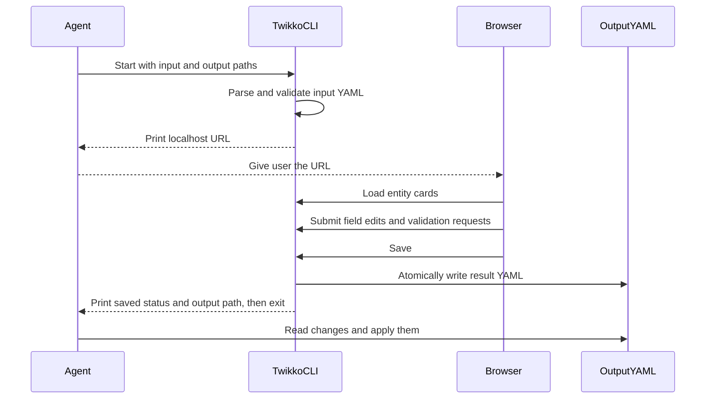
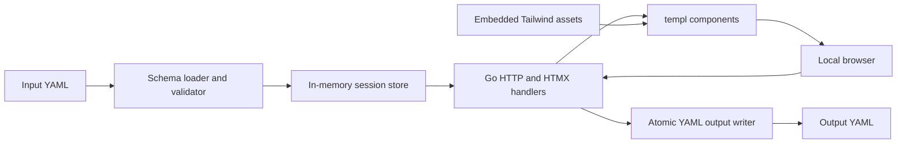

# Twikko POC product requirements

## Summary

Twikko is a temporary local web editor for a set of structured entities.
An agent writes the entities and an explicit schema to YAML, launches the
editor, and gives the local URL to the user. The user makes bulk changes in the
browser. When they save, Twikko writes a YAML result that the agent can
apply to Jira, a database, or another source system.

The POC focuses on a safe hand-off between an agent and a person. It does not
connect to source systems itself.

## Problem

Chat is a poor place to review and change several records with many fields.
The user needs to compare values, edit long text, select valid enum values,
and make a deliberate save decision. A short-lived local editor gives the user
the right control without adding a permanent service or integration.

## Goals

- Load existing entities from YAML.
- Use an explicit field schema to render controls and validate edits.
- Let one user edit entities in a card-based browser UI.
- Support text, multiline text, number, boolean, enum, multi-select, and date
  fields.
- Allow any field to be read-only.
- Stop invalid saves with basic validation.
- Write a full entity result and a concise change summary in YAML.
- Run only on the local machine for the life of the editing session.

## Non-goals

- Create or delete entities.
- Edit remotely or support multiple users.
- Authenticate users.
- Read JSON or CSV.
- Infer a schema from entity values.
- Call Jira, databases, or any third-party API.
- Keep state after the process exits.
- Support validation rules beyond required values, type checks, and allowed
  enum values.
- Offer a table view in the POC.

## Users

The direct user is a person reviewing a set of proposed or requested changes.
The caller is an agent that prepares input and consumes output.

## Primary flow



If the user selects Cancel, the CLI writes a cancelled result, reports it, and
exits. The agent must not apply changes from a cancelled result.

## Command-line interface

```text
twikko --input in.yaml --output out.yaml [--port 0] [--open]
```

Arguments:

- `--input` is the required YAML document containing the schema and entities.
- `--output` is the required YAML file written when the session ends.
- `--port` defaults to `0`, which asks the operating system for an available
  port.
- `--open` opens the local URL in the default browser. Without it, the caller
  can open the URL itself.

Startup behavior:

1. Parse and validate the input before starting the HTTP server.
2. Bind only to `127.0.0.1`.
3. Print the full local URL to standard output.
4. Keep the process alive until Save, Cancel, or an interrupt.

Completion behavior:

- Print the final `status` and output path to standard output.
- Exit with `0` after a save.
- Exit with `2` after a cancel, including Ctrl+C.
- Exit with `1` for input, server, or output errors.

## Agent waiting protocol

The calling agent launches the CLI as a background process and waits for up to
five minutes. A save or cancel causes the process to write the output and exit.

If five minutes pass with no output, the agent ends its current loop and tells
the user to send `continue` once they finish editing. The CLI and browser stay
available. On `continue`, the agent checks whether the process exited and
whether the output file exists. It then reads the output before continuing its
source-system work.

## Input YAML

The input has `schema` and `entities` keys, and optional top-level `title` and
`description` keys. They head the page and set the browser tab title. A
description keeps its line breaks. Both must be text. Without a title the page
reads `Twikko`, and without a description no text shows under it. The
page ends with a fixed, non-editable footer reading `Twikko, 2026`.

`schema.id_field` names a field that identifies each entity. The optional
`schema.title_field` names an entity key whose value is the card title. The key
does not have to be declared in `schema.fields`, so it is not an input and the
user cannot edit it. A title value must be a scalar. A card falls back to the
identifier when `title_field` is unset or the entity has no value for it.

The optional `schema.header` replaces the plain title with a list of widgets.
It cannot be combined with `title_field`. Each widget has:

- `type`: a display widget `icon`, `tag`, or `text`, or a control. See
  "Widgets" below.
- `source`. For a display widget, an entity key or a dotted path into nested
  mappings, which must hold a scalar. It may name a key the schema does not
  declare. An entity with no value at the source leaves the widget empty, and
  an empty header widget leaves no gap. A source found in no entity fails the
  load, because it is almost certainly a typo.
- `variants`, for `icon` and `tag`: a map from a value, matched exactly, to
  `intent` and, for icons only, `icon`. `intent` is `neutral` (the default),
  `info`, `success`, `warning`, or `danger`. An icon whose value matches no
  variant draws `square-rotated` in the neutral intent.
- `style`, for `text`: `bold`, `italic`, `muted`. The set is closed because
  Tailwind needs every class spelled out at build time.

`header: { template: <name> }` selects a widget list built into the binary,
for example `gojira` for tickets pulled by the gojira skill. A template cannot
be extended. An unknown template name or icon name fails the load and the
error lists the valid ones. Unknown keys in a widget fail the load too.

The optional `schema.body` lays the card body out in rows. It is a list of rows,
each a list of one to four widgets, with at most ten rows. A row's widgets
share its width equally. `hline` and `vline` widgets draw 1px separator lines and
do not count in those limits: a row holding one `hline` is not one of the ten
rows, and a `vline` is not one of the four cells. A `vline` takes only its own
width, with its height the height of its row, so it never changes the layout. It
must sit between two widgets. An `hline` is a row of its own, and a header takes
`vline` only. A line takes an optional `intent` for its colour. A body widget has the same keys and rules as a header
widget (see "Widgets"). A display widget with no value stays an empty slot so
columns do not shift between cards, and a row with no content at all is hidden.
A body `text` widget wraps and keeps line breaks.

A schema field that no control places is not shown once a body is set. It stays
in the output unchanged. The load fails when a field has two controls, when a
layout breaks a limit, when a display source is found in no entity, and when a
required, editable field would be hidden, because it could block Save with no
visible cause. `body: { template: <name> }` selects a layout built into the
binary, for example `gojira`. A template's sources are optional, so the "found
in no entity" check skips it. Without `schema.body`, every field that no header
control edits shows in a two-column grid in schema order.

### Widgets

A widget is one piece of the card header or body. Its keys are `type`, `source`,
`label`, `options`, `variants`, and `style`. Unknown keys fail the load.

A display widget is `icon`, `tag`, or `text`. It is read-only and follows the
current values. `variants` map a value to an `intent`, and for icons to an
`icon`. `style` applies to `text`. A display widget shows `label` as a caption
in the body and as a muted prefix in the header.

A control edits one field, and `source` names a field declared in
`schema.fields`. `type: control`, which is also the default when `type` is
omitted, draws the control that fits the field's data type. Naming a control
type overrides that, so a tailored case can ask for another control:

| Field type | `control` draws | Types that may override it |
| --- | --- | --- |
| `text` | `input` | `textarea`, `select` |
| `longtext` | `textarea` | `input` |
| `number` | `number` | none |
| `bool` | `toggle` | none |
| `enum` | `select` | none |
| `multienum` | `multiselect` | none |
| `date`, `time`, `datetime` | `date`, `time`, `datetime` | none |

An override only changes how the same kind of value is drawn. A control that
does not fit the field type fails the load, and the error lists the controls
that do. A `select` over a `text` field needs `options` on the widget, and the
field then accepts only those values, or empty when not required. The server
enforces that on direct requests too. `options` is rejected anywhere else, since
an `enum` field has its own. `variants` and `style` are rejected on a control.

`label` replaces the field label above a control in the body. A `toggle` shows
it to the right of the switch, and it is optional: without it the switch shows
no text, and the field label stays its accessible name. In the header a control
shows no visible label and uses it as its tooltip and accessible name, except
a toggle, which shows its label.

A field has at most one control across header and body. A control in the
header works while the card is collapsed.

`time` is `HH:MM` and `datetime` is `YYYY-MM-DDTHH:MM`, with seconds accepted,
and no time zone. Both are stored as written.
`schema.fields` defines every editable or displayed field. Field definitions contain:

- `name`, the key in an entity object.
- `label`, the UI label. If absent, use `name`.
- `type`, one of `text`, `longtext`, `number`, `bool`, `enum`, `multienum`,
  `date`, `time`, or `datetime`.
- `required`, optional and false by default.
- `readonly`, optional and false by default.
- `options`, required for `enum` and `multienum`, and forbidden for other
  types.

```yaml
schema:
  id_field: key
  fields:
    - name: key
      label: Ticket
      type: text
      readonly: true
    - name: summary
      type: text
      required: true
    - name: description
      type: longtext
    - name: status
      type: enum
      options: [To Do, In Progress, Done]
    - name: labels
      type: multienum
      options: [backend, ui, bug]
    - name: points
      type: number
    - name: due
      type: date
    - name: blocked
      type: bool
entities:
  - key: PROJ-1
    summary: Fix login
    description: Users cannot sign in after resetting a password.
    status: To Do
    labels: [bug]
    points: 3
    due: 2026-10-20
    blocked: false
```

The loader must preserve unknown keys in each entity. The UI does not render
them in the POC, but they must appear unchanged in a saved result.

## Output YAML

Save writes this shape:

```yaml
status: saved
saved_at: 2026-10-13T08:15:30Z
changes:
  - entity_id: PROJ-1
    field: status
    from: To Do
    to: In Progress
entities:
  - key: PROJ-1
    summary: Fix login
    description: Users cannot sign in after resetting a password.
    status: In Progress
    labels: [bug]
    points: 3
    due: 2026-10-20
    blocked: false
```

`changes` contains one entry for each changed field. Values retain their YAML
types where possible. `entities` contains all entities in their final form,
including unedited entity keys that were not declared by the schema.

Cancel writes:

```yaml
status: cancelled
```

The program writes output atomically by creating a temporary file in the
target directory and renaming it to `--output`.

## UI requirements

- Render one card for each entity.
- Show the card title in each card header: the `header` widgets, else the
  `title_field` value, else the identifier.
- Put an eye toggle button at the left of the card header, before the title.
  An open eye means the card is expanded and a crossed eye means it is
  collapsed. Pressing it collapses or expands the card. A collapsed card shows
  a changed-field count and a validation-error marker in the header, so a hidden
  edit or error is not lost. The collapsed state lives in session memory and is
  not written to the output.
- Place header widgets left-aligned between the eye toggle and the ellipsis
  menu, with an equal gap. A text widget truncates when space runs out. Widgets
  show the current values, so editing a field refreshes the widgets bound to
  it without a reload. An icon-only widget carries its value as an accessible
  name and tooltip. A collapsed card keeps its changed-count and error markers
  after the widgets.
- Lay the body out in the rows and columns of `schema.body`. Below the `md`
  breakpoint every row stacks to one column. Without `schema.body`, show every
  field that no header control edits in a two-column grid.
- Draw a header control at the same height as the other widgets, with no
  visible label, and show a validation error under it. The changed-count and
  error badges of a collapsed card refresh after an edit in a header control.
- Put card actions in an ellipsis menu at the right of the header. The menu
  holds "Reset", which restores the card to its input values and keeps its
  collapsed state. More actions will join it later.
- Render a control that matches the field type, unless the widget names another
  that fits it:
  - `text`: single-line input.
  - `longtext`: textarea.
  - `number`: numeric input.
  - `bool`: on/off switch, with the widget label to its right when given.
  - `enum`: select.
  - `multienum`: checkbox group or another accessible multi-select control.
  - `date`, `time`, `datetime`: date, time, and date-time inputs.
- Render read-only values without allowing mutation.
- Mark fields whose value differs from the input.
- Display a global count of changed fields or entities.
- Keep Save and Cancel in a sticky action bar.
- Show field-level validation errors next to the relevant control.
- Disable or reject Save while validation errors exist.

The UI uses reusable `templ` components:

- `Layout`
- `EntityCard`
- `CardMenu`
- field-input components or variants for every supported type
- `ValidationMessage`
- `SaveBar`

HTMX requests partial updates for edits, validation feedback, changed markers,
and the global change count. The Go process holds the working state in memory.

Tailwind styles components. Use the standalone Tailwind CLI so the POC has no
Node runtime requirement.

The look is neutral and close to system UI, modelled on shadcn/ui: its neutral
colour tokens, a light and a dark theme that follows the operating-system
setting, small radii and subtle borders. Icons come from Tabler, vendored as
`.svg` files and drawn as CSS masks, not embedded in templates.

## Validation

At load time, reject input where:

- the schema has no valid identifier field;
- a field name appears more than once;
- a field type is unsupported;
- an enum or multi-select field lacks options;
- an entity lacks its identifier; or
- a schema-defined value has the wrong type.

During editing, reject:

- empty required values;
- non-numeric values for number fields;
- invalid dates;
- a value outside an enum's options; and
- any multi-select member outside its options.

The server must reject attempted writes to read-only fields even if a client
submits one directly.

## Security and lifecycle

- Listen on `127.0.0.1`, never a public interface.
- Start only after input validation succeeds.
- Run until Save, Cancel, or interrupt.
- Treat Ctrl+C as cancel and write a cancelled result when possible.
- Keep the session in memory only.
- Include a random session token in the local URL if practical. HTTP handlers
  must require that token for state-changing requests.

## Implementation shape



All generated templates and static assets ship in the compiled Go binary via
`go:embed`.

## Acceptance criteria

```gherkin
Feature: edit YAML entities locally

  Scenario: Load entities into cards
    Given a valid YAML input with two entities and an explicit schema
    When the caller starts Twikko
    Then the CLI prints a URL on 127.0.0.1
    And the browser displays one card for each entity
    And each field uses the control selected by its schema type

  Scenario: 1 - A card header combines several pieces of ticket data
    Given an input that asks for a ticket type icon, the ticket id, and the title in the header
    When the user opens the editor
    Then each card shows the icon, the id and the title side by side between the eye toggle and the actions menu

  Scenario: 2 - A value maps to an icon and colour
    Given an input that maps the type "Bug" to a red bug icon
    When the user opens the editor
    Then a bug ticket shows a red bug icon
    And a ticket of an unmapped type shows a neutral diamond icon

  Scenario: 3 - A header piece with no data is skipped
    Given a ticket without a due date and a header that shows the due date
    When the user opens the editor
    Then that ticket's header shows no due date and no empty gap

  Scenario: 4 - The header follows edits
    Given a header that shows a ticket's status
    When the user changes the status field
    Then the header shows the new status without a page reload

  Scenario: 5 - An input with no header settings looks as before
    Given an input without header settings
    When the user opens the editor
    Then each card shows its title as it does today

  Scenario: 6 - A misconfigured header is rejected
    Given an input whose header refers to an unknown widget, icon, or template
    When the agent starts the editor
    Then the editor refuses to start and names the problem and the valid choices

  Scenario: 7 - An agent picks a ready-made header by name
    Given an input that selects a built-in header template
    When the user opens the editor
    Then the cards show the header that template defines

  Scenario: 8 - Fields appear in the rows and columns the input asks for
    Given an input that puts the summary alone in the first row and created and due side by side in the second
    When the user opens the editor
    Then each card shows the summary across the full width
    And created and due share the next row in equal halves

  Scenario: 9 - A row can hold up to four columns
    Given an input with a row of four fields
    When the user opens the editor
    Then the four fields share that row in equal quarters

  Scenario: 10 - Fields the layout leaves out are not shown but are kept
    Given an input whose layout does not place the assignee
    When the user edits a card and saves
    Then the card does not show the assignee
    And the saved result still holds the original assignee

  Scenario: 11 - A cell can present data without editing it
    Given an input that shows the creator as plain text with the caption "Creator"
    When the user opens the editor
    Then the card shows "Creator" and the name as text, with nothing to type into

  Scenario: 12 - A cell can show a status as a tag
    Given an input that shows the status as a tag in the body
    When the user opens the editor
    Then the card shows the status as a coloured tag

  Scenario: 13 - Presented data follows edits
    Given a layout that edits the status in one cell and shows the status as a tag in another
    When the user changes the status
    Then the tag shows the new status without a page reload
    And the control the user is typing in keeps focus

  Scenario: 14 - A cell caption replaces the field name
    Given a layout whose cell is captioned "Due date" for a field named "due"
    When the user opens the editor
    Then the card labels that control "Due date"

  Scenario: 15 - A missing value does not shift the columns
    Given a layout that shows creator and due side by side
    And a ticket without a due date
    When the user opens the editor
    Then that ticket's due slot is blank and the creator stays in the first column

  Scenario: 16 - An input without a layout looks as before
    Given an input without layout settings
    When the user opens the editor
    Then every card shows all fields in the usual two-column grid

  Scenario: 17 - A layout that breaks the limits is rejected
    Given a layout with more than ten rows, a row with five cells, or an empty row
    When the agent starts the editor
    Then the editor refuses to start and says which row is wrong

  Scenario: 18 - A layout that cannot work is rejected
    Given a layout that names an unknown field, places a field twice, or leaves out a required editable field
    When the agent starts the editor
    Then the editor refuses to start and names the field

  Scenario: 19 - An agent picks a ready-made layout by name
    Given an input that selects a built-in body layout
    When the user opens the editor
    Then the cards show the layout that template defines

  Scenario: 20 - An unknown layout name is rejected with the choices
    Given an input that selects a layout name that does not exist
    When the agent starts the editor
    Then the editor refuses to start and lists the available layouts

  Scenario: 21 - A control matches the kind of data
    Given an input with a short text, a long text, a number, a yes/no value, a choice, a date, a time and a date-time
    When the user opens the editor
    Then each is edited with the control that fits it: a text box, a large text area, a number box, an on/off switch, a drop-down, and date, time and date-time pickers

  Scenario: 22 - An input can ask for a different control
    Given an input that asks for a short text to be edited in a large text area
    When the user opens the editor
    Then that field is edited in a large text area

  Scenario: 23 - A text field can become a choice from a given list
    Given an input that offers the choices "Backend" and "Frontend" for a text field
    When the user opens the editor
    Then the field is a drop-down with those two choices

  Scenario: 24 - A value outside the offered choices is refused
    Given a text field that offers only "Backend" and "Frontend"
    When a client submits "Ops" for that field
    Then the server reports a field-level error and does not accept the value

  Scenario: 25 - An on/off switch shows an optional label to its right
    Given an input with a switch labelled "Blocked" and another switch without a label
    When the user opens the editor
    Then the first switch shows "Blocked" to its right
    And the second shows no text

  Scenario: 26 - Controls can sit in the card header
    Given an input that puts the status control and the ticket id in the header
    When the user opens the editor
    Then the header shows the id and a working status control between the eye toggle and the actions menu

  Scenario: 27 - A header control works while the card is collapsed
    Given a collapsed card with a status control in its header
    When the user changes the status
    Then the card shows that one field changed, without expanding

  Scenario: 28 - A field shown in the header is not repeated in the body grid
    Given an input with a status control in the header and no body layout
    When the user opens the editor
    Then the status is edited once, in the header, and is absent from the grid below

  Scenario: 29 - One field cannot have two controls
    Given an input that places the same field in the header and in the body
    When the agent starts the editor
    Then the editor refuses to start and names the field

  Scenario: 30 - Presented data follows edits made in any control
    Given a header tag and a body caption that show the status, and a control that edits it in the header
    When the user changes the status
    Then the tag and the caption show the new status without a reload
    And the control keeps focus

  Scenario: 31 - A control that does not fit the data is rejected
    Given an input that asks for a number field to be edited in a large text area
    When the agent starts the editor
    Then the editor refuses to start and lists the controls that fit a number

  Scenario: 32 - A text field offered as a drop-down needs its choices
    Given an input that asks for a text field to be a drop-down without giving choices
    When the agent starts the editor
    Then the editor refuses to start and says the choices are missing

  Scenario: 33 - Time and date-time values are checked
    Given a time field and a date-time field
    When a client submits "25:99" and "yesterday"
    Then the server reports a field-level error for each

  Scenario: 34 - Existing inputs keep working
    Given an input written for the previous layout settings, with display widgets and fields in rows
    When the user opens the editor
    Then the cards look and behave as before

  Scenario: Save valid changes
    Given the editor is open with valid entities
    When the user changes a field and selects Save
    Then the output YAML has status "saved"
    And it includes the full edited entities
    And it records the old and new value in changes
    And Twikko exits with code 0

  Scenario: Reject invalid changes
    Given an enum field allows "To Do" and "Done"
    When a client submits "Blocked" for that field
    Then the server reports a field-level validation error
    And the user cannot save until the value is valid

  Scenario: Protect read-only fields
    Given a field is marked readonly
    When a client submits a changed value for the field
    Then the server rejects the change
    And the saved entity keeps its input value

  Scenario: Cancel an editing session
    Given the editor is open
    When the user selects Cancel
    Then the output YAML has status "cancelled"
    And it contains no entities
    And Twikko exits with code 2

  Scenario: Finish after the agent wait window
    Given the agent has waited five minutes without a result
    When the user saves and then sends "continue" to the agent
    Then the agent reads the saved output before applying changes
```

## Future work

- Add and delete entities.
- JSON and CSV adapters.
- Spreadsheet-like table view.
- Extended validation constraints.
- Schema inference.
- An agent skill or wrapper command that prepares files, starts the session,
  waits for completion, and applies the result.
